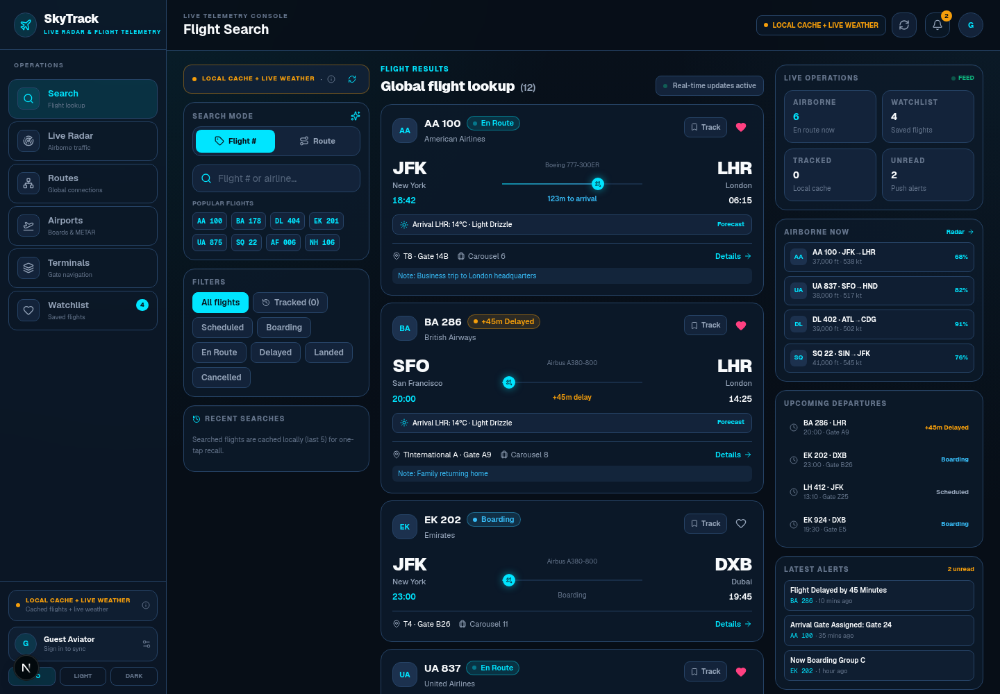
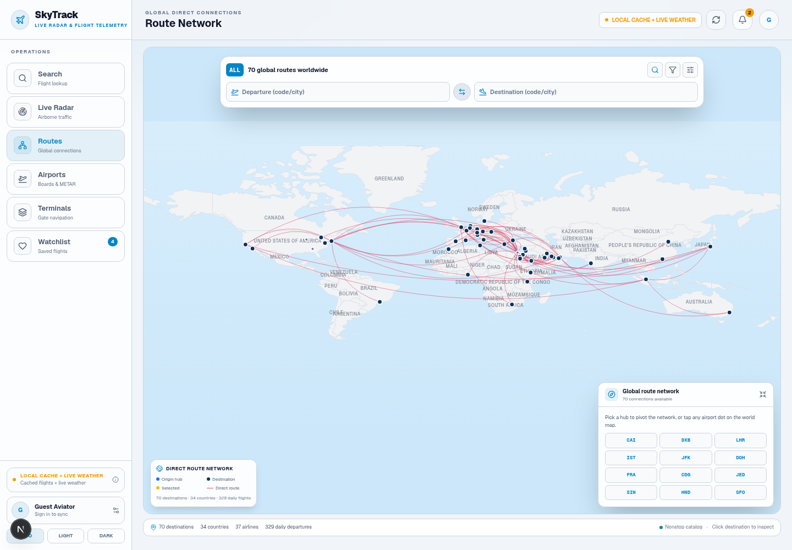
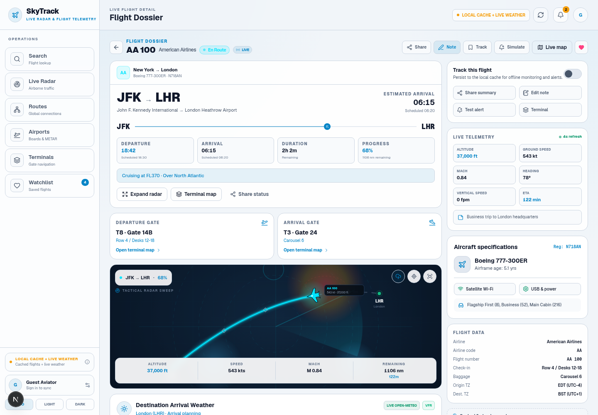
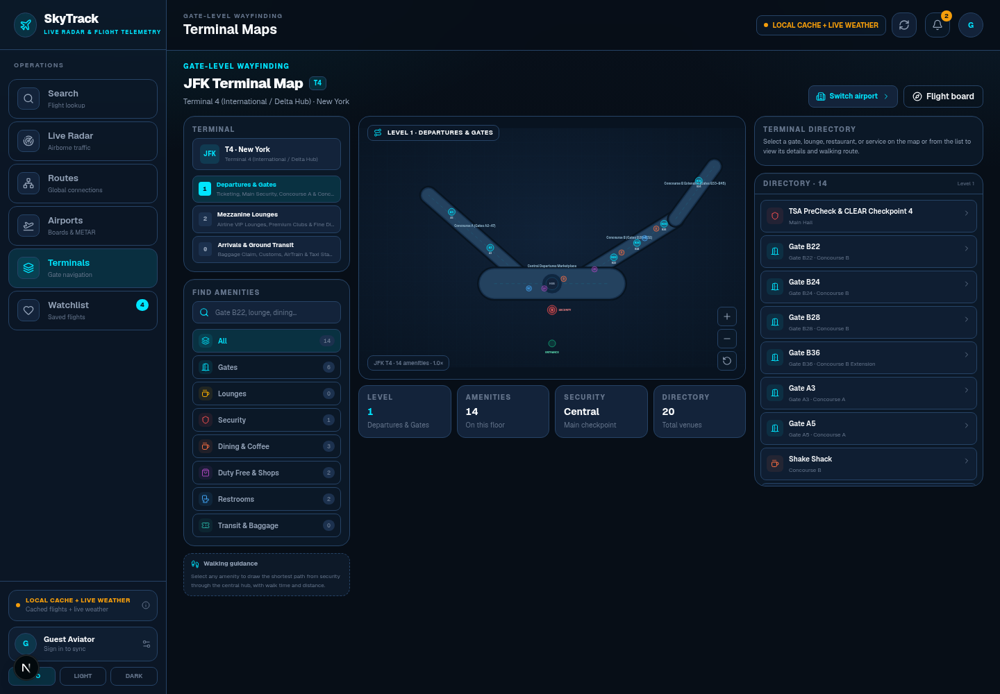

# SkyTrack Desktop

The desktop web edition of **SkyTrack** — a live flight tracking assistant with an interactive radar, global route network, airport boards, terminal wayfinding, destination weather, push alerts, and an offline watchlist.

Built with **Next.js 16 (App Router)**, **React 19**, **TypeScript**, and **Tailwind CSS v4**. The theme, palette, typography hierarchy, status colors, and aviation-instrument UI language are shared with the Android app in `../avi`.

> The Android project was not modified. This repository is an additive, desktop-first companion experience.

## Preview

| Flight search | Global route network |
| --- | --- |
|  |  |

| Flight dossier | Terminal wayfinding |
| --- | --- |
|  |  |

---

## Feature parity

| Android feature | Desktop implementation |
| --- | --- |
| Flight number / airline search | `/search` with flight-number mode, airline / city / aircraft matching, quick flights, and debounced live AeroDataBox merge |
| Route lookup | `/search` route mode with origin/destination inputs, swap, reset-all, popular routes, and deep links from the route inspector |
| Status + tracked filters | Status chips and local tracked-flight filter, plus all cached results and empty states |
| Recent searches | Last 5 searches persisted in local storage, one-tap reopen, per-item delete and clear-all |
| Live tactical radar | `/radar` with animated radar sweep, range rings, weather cells, aircraft silhouette, heading vector, zoom/pan, and 4-second telemetry ticks |
| Flight dossier | `/flight/[id]` with status header, route progress, gate/terminal tiles, live radar, destination weather, METAR comparison, timeline, aircraft specs, notes, sharing, and alert simulation |
| Live flight map | `/map/[id]` with a full-height vector world map, great-circle route, aircraft marker, route stats, night/vector styles, and telemetry HUD |
| Global route network | `/routes` with 50 airports, 70+ nonstop route specs, hub search, origin/destination autocomplete, pivot history, direction/haul/region/airline filters, route inspector, and airport-board links |
| Airport boards | `/airports` with 11 hub boards, departures/arrivals, airline filters, cached FIDS rows, airport METAR/runway panel, and a global airport explorer |
| Terminal maps | `/terminals` with terminal layouts (JFK T4, LHR T5, SFO International, DXB T3), floor switching, category filters, amenity directory, walking route, gate deep links |
| Watchlist / favorites | `/watchlist` with favorites, tracked, and all-saved views, quick alert tests, share actions, and alert inbox |
| Push alerts & scheduling | Alerts dialog with live inbox, mark-read, browser notifications, FCM device token, instant alert simulator, and 10/20/30-second scheduled alerts |
| Account & settings | Google sign-in through Firebase Auth, theme mode (System/Light/Dark), offline mode, sync status, and FCM token |
| Offline caching | Flights, favorites, tracked flights, notes, recent searches, alerts, and schedules persist in local storage; all screens remain navigable offline |
| Firestore sync | `users/{uid}`, `users/{uid}/trackedFlights/{flightId}`, `users/{uid}/alerts/{alertId}` with the Android app's validation rules |
| Theme / colors | Same deep-space cockpit palette, radar cyan, aero blue, instrument surfaces/borders, and aviation status colors; light theme uses the app's light palette |

### Desktop UX adaptations

- Persistent left operations sidebar with live watchlist count and system status.
- Multi-pane layouts: filters, results, and live telemetry are visible simultaneously.
- Sticky rails, dense airport tables, full-height maps, and floating desktop inspectors.
- Keyboard-accessible flight cards and dialogs; ESC closes overlays.
- Responsive fallbacks to a mobile bottom navigation for narrow viewports.

---

## Services & environment

The desktop app uses the same service family as the Android app. **No production secrets are committed.** Copy `.env.example` → `.env.local` and provide your own values.

| Service | Variables | Purpose |
| --- | --- | --- |
| AeroDataBox (RapidAPI) | `AERODATABOX_API_KEY`, `AERODATABOX_API_HOST` | Live flight lookup, airport FIDS boards, daily route stats. Server-only. |
| Open-Meteo | none (zero-key) | Destination arrival forecasts, live METAR-style conditions, VFR/MVFR/IFR categorization. |
| Firebase Auth | `NEXT_PUBLIC_FIREBASE_*` | Google sign-in and verified account state. |
| Cloud Firestore | `NEXT_PUBLIC_FIRESTORE_DATABASE_ID` + Firebase vars | Profile, watchlist, notes, and alerts. Uses the named database from the Android app. |
| Firebase App Check | `NEXT_PUBLIC_FIREBASE_APPCHECK_SITE_KEY` | reCAPTCHA v3 attestation (optional, gracefully skipped). |
| Firebase Cloud Messaging | `NEXT_PUBLIC_FIREBASE_VAPID_KEY` | Web push token registration; falls back to an in-app/local device token. |
| Google Maps | `MAPS_API_KEY`, `NEXT_PUBLIC_GOOGLE_MAPS_API_KEY` | Reserved for parity with the Android Google Maps key. The shipped map uses a bundled Natural Earth vector basemap so it works without a key. |

When AeroDataBox is not configured, the app serves the authentic local cache and shows a clear data-source diagnostic instead of failing. Weather remains live via Open-Meteo.

---

## Getting started

```bash
npm install
cp .env.example .env.local
# fill in your own service values (optional for a local demo)
npm run dev
```

Open <http://localhost:3000>.

Production checks:

```bash
npm run typecheck
npm run lint
npm run build
npm start
```

---

## Firebase setup

1. Create a Firebase Web App in the same project as the Android app.
2. Enable **Google** under Authentication → Sign-in method.
3. Create Firestore with the named database used by the Android app, or set `NEXT_PUBLIC_FIRESTORE_DATABASE_ID` to match.
4. Deploy the shared rules:

   ```bash
   firebase deploy --only firestore:rules
   ```

5. (Optional) Enable App Check with reCAPTCHA v3 and add the site key.
6. (Optional) Generate a Web Push certificate and add the VAPID key.
7. Paste the web app config values into `.env.local`.

The Firestore schema is documented in `firebase-blueprint.json`, and the rules in `firestore.rules` mirror the Android project exactly.

---

## Data & caching model

- `src/data/flights.json` — 12 realistic mock flights with full telemetry, weather, gates, timelines, and notes.
- `src/data/airports.json` — 50 global airport nodes used by the route network.
- `src/data/routes.json` — 70 nonstop route specs with operating carriers, flight numbers, frequencies, and aircraft types.
- `src/data/realtime-airports.json` — 13 airport telemetry/METAR records.
- `src/data/terminal-layouts.json` — extracted terminal floors, concourses, gates, and 35 amenities.
- `src/data/world-countries.json` — Natural Earth country polygons for the zero-request vector maps.

The app hydrates local state after the first paint, avoiding hydration mismatches while keeping SSR content meaningful. The air-telemetry simulator advances en-route flights every 4 seconds, matching the Android refresh cadence.

---

## Project structure

```
src/
├── app/
│   ├── search/            # Flight number + route lookup
│   ├── radar/             # Tactical live radar
│   ├── routes/            # Global direct-connection map
│   ├── airports/          # Boards + airport explorer
│   ├── terminals/         # Terminal wayfinding
│   ├── watchlist/         # Favorites + tracked flights
│   ├── flight/[id]/       # Flight dossier
│   ├── map/[id]/          # Full-screen live map
│   └── api/               # AeroDataBox, Open-Meteo, status routes
├── components/            # Shell, maps, cards, dialogs, UI primitives
├── data/                  # Extracted aviation catalogs
└── lib/
    ├── store.tsx          # App state, local cache, alerts, auth sync
    ├── firebase.ts        # Auth, Firestore, App Check, FCM
    ├── aerodatabox.ts     # Server-side DTO mapper
    ├── weather.ts         # Open-Meteo mapper + fallbacks
    ├── data.ts            # Route network builder
    ├── types.ts           # Shared domain models
    └── utils.ts           # Formatting, geodesic math, status metadata
```

---

## Deployment

The app deploys cleanly to Vercel (or any Node host):

1. Import this repository.
2. Add the environment variables from `.env.example`.
3. Deploy. API routes run server-side so `AERODATABOX_API_KEY` never reaches the browser.

Firebase Hosting can also be used, but Vercel is recommended for Next.js App Router features.

---

## Status

- Android app left untouched.
- All desktop routes build and render with no runtime or hydration errors.
- Local-cache demo works without any keys; live AeroDataBox and Firestore activate automatically when configured.
