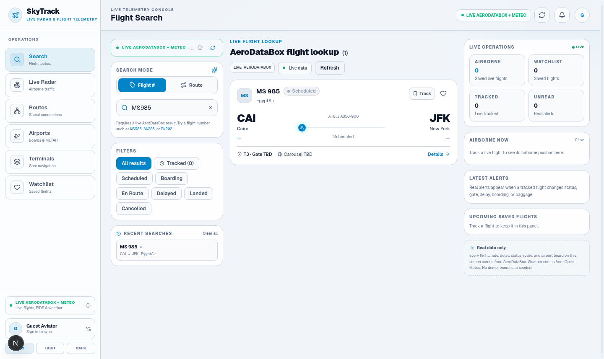
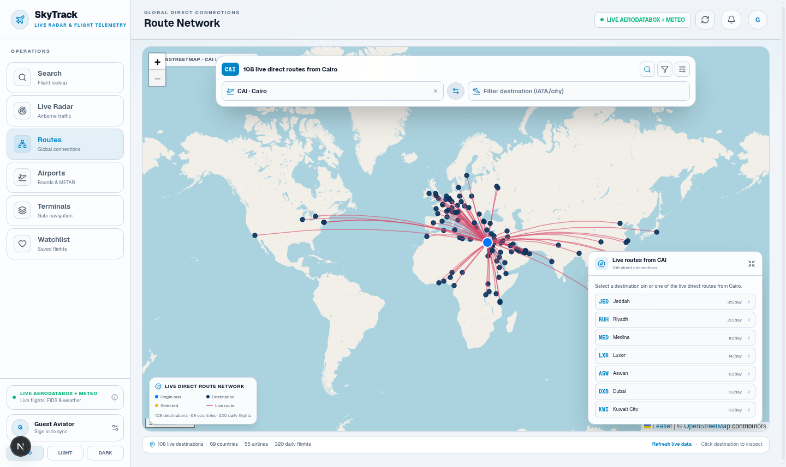
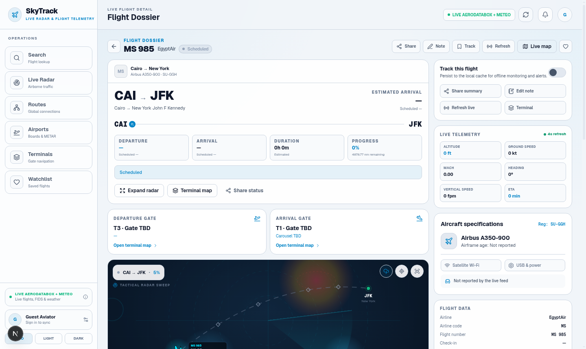
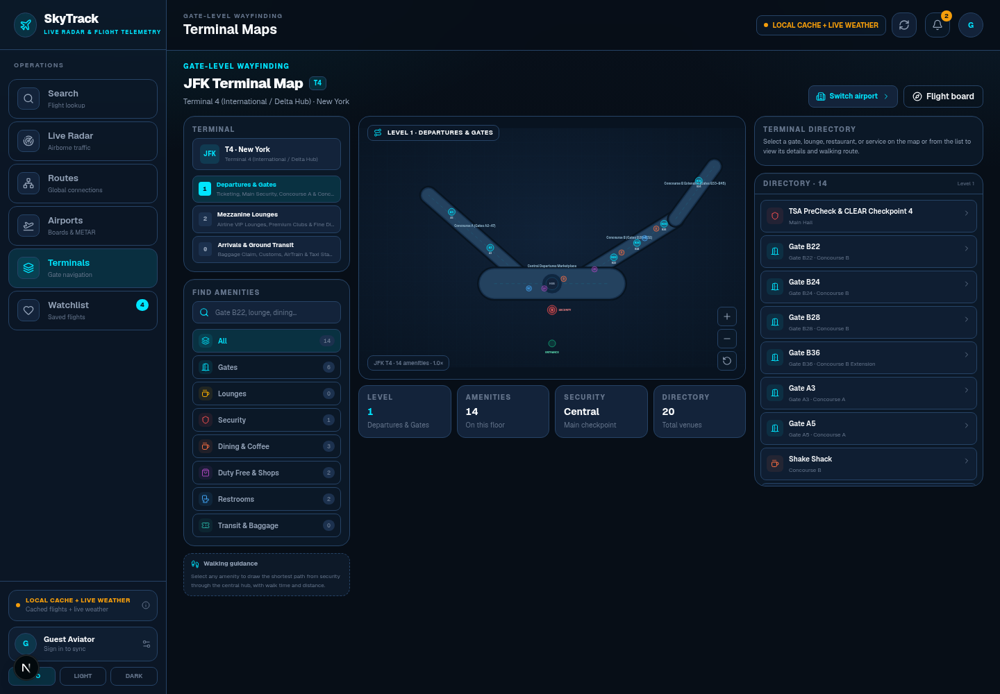

# Avi Web

> This app is now `@avi/web` inside the Avi monorepo. Use the root [`README.md`](../../README.md) and [`docs/supabase.md`](../../docs/supabase.md) for current setup. Firebase/Firestore references below are historical and are being replaced by Supabase.

# SkyTrack Desktop

The desktop web edition of **SkyTrack** — a live flight tracking assistant with an interactive radar, global route network, airport boards, terminal wayfinding, destination weather, push alerts, and an offline watchlist.

Built with **Next.js 16 (App Router)**, **React 19**, **TypeScript**, and **Tailwind CSS v4**. The theme, palette, typography hierarchy, status colors, and aviation-instrument UI language are shared with the Android app in `../avi`.

> The Android project was not modified. This repository is an additive, desktop-first companion experience.

## Preview

| Flight search | Global route network |
| --- | --- |
|  |  |

| Flight dossier | Terminal wayfinding |
| --- | --- |
|  |  |

---

## Feature parity

| Android feature | Desktop implementation |
| --- | --- |
| Flight number / airline search | `/search` with flight-number mode, airline / city / aircraft matching, quick flights, and debounced live AeroDataBox merge |
| Route lookup | `/search` route mode with origin/destination inputs, swap, reset-all, popular routes, and deep links from the route inspector |
| Status + tracked filters | Status chips and local tracked-flight filter, plus all cached results and empty states |
| Recent searches | Last 5 searches persisted in local storage, one-tap reopen, per-item delete and clear-all |
| Live tactical radar | `/radar` with animated radar sweep, range rings, live aircraft positions when reported, heading vector, and zoom/pan |
| Flight dossier | `/flight/[id]` with status header, route progress, gate/terminal tiles, live radar, destination weather, METAR comparison, timeline, aircraft specs, notes, sharing, and alert simulation |
| Live flight map | `/map/[id]` with Google Maps when `NEXT_PUBLIC_GOOGLE_MAPS_API_KEY` is set, plus an OpenStreetMap fallback, great-circle route, live aircraft marker, route stats, and telemetry HUD |
| Global route network | `/routes` with real AeroDataBox daily routes, OpenStreetMap tiles, hub search, origin/destination filtering, pivot history, haul/region/airline filters, route inspector, and airport-board links |
| Airport boards | `/airports` with 11 hub boards, departures/arrivals, airline filters, cached FIDS rows, airport METAR/runway panel, and a global airport explorer |
| Terminal maps | `/terminals` with terminal layouts (JFK T4, LHR T5, SFO International, DXB T3), floor switching, category filters, amenity directory, walking route, gate deep links |
| Watchlist / favorites | `/watchlist` with favorites, tracked, and all-saved views, quick alert tests, share actions, and alert inbox |
| Push alerts & scheduling | Alerts dialog with live inbox, mark-read, browser notifications, FCM device token, instant alert simulator, and 10/20/30-second scheduled alerts |
| Account & settings | Google sign-in through Firebase Auth, theme mode (System/Light/Dark), offline mode, sync status, and FCM token |
| Offline caching | Flights, favorites, tracked flights, notes, recent searches, alerts, and schedules persist in local storage; all screens remain navigable offline |
| Firestore sync | `users/{uid}`, `users/{uid}/trackedFlights/{flightId}`, `users/{uid}/alerts/{alertId}` with the Android app's validation rules |
| Maps | Google Maps (browser key) for the flight map, plus OpenStreetMap tiles for the live route network and as a no-key fallback. |
| Theme / colors | Same deep-space cockpit palette, radar cyan, aero blue, instrument surfaces/borders, and aviation status colors; light theme uses the app's light palette |

### Desktop UX adaptations

- Persistent left operations sidebar with live watchlist count and system status.
- Multi-pane layouts: filters, results, and live telemetry are visible simultaneously.
- Sticky rails, dense airport tables, full-height maps, and floating desktop inspectors.
- Keyboard-accessible flight cards and dialogs; ESC closes overlays.
- Responsive fallbacks to a mobile bottom navigation for narrow viewports.

---

## Services & environment

The desktop app uses the same service family as the Android app. **No production secrets are committed.** Copy `.env.example` → `.env.local` and provide your own values.

| Service | Variables | Purpose |
| --- | --- | --- |
| AeroDataBox direct API | `AERODATABOX_API_KEY`, `AERODATABOX_API_HOST` | Live flight lookup, airport FIDS boards, daily route stats. Server-only. |
| Open-Meteo | none (zero-key) | Destination arrival forecasts, live METAR-style conditions, VFR/MVFR/IFR categorization. |
| Firebase Auth | `NEXT_PUBLIC_FIREBASE_*` | Google sign-in and verified account state. |
| Cloud Firestore | `NEXT_PUBLIC_FIRESTORE_DATABASE_ID` + Firebase vars | Profile, watchlist, notes, and alerts. Uses the named database from the Android app. |
| Firebase App Check | `NEXT_PUBLIC_FIREBASE_APPCHECK_SITE_KEY` | reCAPTCHA v3 attestation (optional, gracefully skipped). |
| Firebase Cloud Messaging | `NEXT_PUBLIC_FIREBASE_VAPID_KEY` | Web push token registration; falls back to an in-app/local device token. |
| Google Maps | `NEXT_PUBLIC_GOOGLE_MAPS_API_KEY` (browser key), `MAPS_API_KEY` | Live Google basemap and route overlays on the flight map. OpenStreetMap is used automatically when the browser key is absent. |

No demo data is seeded. Without AeroDataBox, flight/route/board screens show a configuration notice and only previously fetched live results from the local cache. Weather remains live via Open-Meteo.

### Where to find the remaining values

| Variable | Where to get it |
| --- | --- |
| `NEXT_PUBLIC_GOOGLE_MAPS_API_KEY` | Google Cloud Console → **APIs & Services → Credentials → API key**. Enable **Maps JavaScript API**. Create a browser key restricted to HTTP referrers (`http://localhost:3000/*`, your domain). The Android `MAPS_API_KEY` may be Android-restricted and not usable on the web. |
| `NEXT_PUBLIC_FIREBASE_MEASUREMENT_ID` | Firebase Console → **Project settings → General → Your apps → Web app → SDK setup and configuration**. Value starts with `G-`. Only present when Google Analytics is enabled. Optional. |
| `NEXT_PUBLIC_FIRESTORE_DATABASE_ID` | Firebase Console → **Firestore Database → Data**. The Android project uses `ai-studio-android-skytrack-ca7ba412-a398-4ae9-99ef-a0b19d1bc846`; set that unless you created a new default database (leave blank for `(default)`). |
| `NEXT_PUBLIC_FIREBASE_VAPID_KEY` | Firebase Console → **Project settings → Cloud Messaging → Web configuration → Web Push certificates → Key pair**. Generate one if missing. Public key. |
| `NEXT_PUBLIC_FIREBASE_APPCHECK_SITE_KEY` | Firebase Console → **App Check → Apps → Web app → reCAPTCHA v3 → Site key**. Or register the domain at <https://www.google.com/recaptcha/admin> (v3). Optional unless App Check is enforced. |
| `FIREBASE_APPCHECK_DEBUG_TOKEN` | Firebase Console → **App Check → Apps → Web app → Manage debug tokens**. Debug-only; leave empty in production. |

Also add your dev and production domains under **Firebase Console → Authentication → Settings → Authorized domains** for Google sign-in.

---

## Getting started

```bash
pnpm install
cp .env.example .env.local
# fill in your own service values (AeroDataBox is required for live flights)
pnpm dev
```

Open <http://localhost:3000>.

Production checks:

```bash
pnpm typecheck
pnpm lint
pnpm build
pnpm start
```

---

## Firebase setup

1. Create a Firebase Web App in the same project as the Android app.
2. Enable **Google** under Authentication → Sign-in method.
3. Create Firestore with the named database used by the Android app, or set `NEXT_PUBLIC_FIRESTORE_DATABASE_ID` to match.
4. Deploy the shared rules:

   ```bash
   firebase deploy --only firestore:rules
   ```

5. (Optional) Enable App Check with reCAPTCHA v3 and add the site key.
6. (Optional) Generate a Web Push certificate and add the VAPID key.
7. Paste the web app config values into `.env.local`.

The Firestore schema is documented in `firebase-blueprint.json`, and the rules in `firestore.rules` mirror the Android project exactly.

---

## Data & caching model

- Live AeroDataBox data — flight search, airport FIDS boards, and daily airport routes.
- Live Open-Meteo data — current airport conditions and destination arrival forecasts.
- `src/data/airports.json` — 50 real airport reference nodes (names, coords, timezones) used for suggestions and map search.
- `src/data/terminal-layouts.json` — schematic terminal floors, concourses, gates, and amenities, explicitly labelled as a reference layout.

No mock flights, alerts, telemetry, device tokens, or demo accounts are bundled. Cached values are only ever real API responses from earlier requests.

The app hydrates local state after the first paint, avoiding hydration mismatches. Tracked and favourite flights are refreshed from AeroDataBox every five minutes (and on demand), and alerts are generated by diffing real successive snapshots. Aircraft positions are shown only when AeroDataBox reports a live location.

---

## Project structure

```
src/
├── app/
│   ├── search/            # Flight number + route lookup
│   ├── radar/             # Tactical live radar
│   ├── routes/            # Global direct-connection map
│   ├── airports/          # Boards + airport explorer
│   ├── terminals/         # Terminal wayfinding
│   ├── watchlist/         # Favorites + tracked flights
│   ├── flight/[id]/       # Flight dossier
│   ├── map/[id]/          # Full-screen live map
│   └── api/               # AeroDataBox, Open-Meteo, status routes
├── components/            # Shell, maps, cards, dialogs, UI primitives
├── data/                  # Extracted aviation catalogs
└── lib/
    ├── store.tsx          # App state, local cache, alerts, auth sync
    ├── firebase.ts        # Auth, Firestore, App Check, FCM
    ├── aerodatabox.ts     # Server-side DTO mapper
    ├── weather.ts         # Open-Meteo mapper + fallbacks
    ├── data.ts            # Route network builder
    ├── types.ts           # Shared domain models
    └── utils.ts           # Formatting, geodesic math, status metadata
```

---

## Deployment

The app deploys cleanly to Vercel (or any Node host):

1. Import this repository.
2. Add the environment variables from `.env.example`.
3. Deploy. API routes run server-side so `AERODATABOX_API_KEY` never reaches the browser.

Firebase Hosting can also be used, but Vercel is recommended for Next.js App Router features.

---

## Status

- Android app left untouched.
- All desktop routes build and render with no runtime or hydration errors.
- Flight data requires `AERODATABOX_API_KEY`; weather is live without a key. Google Maps requires a browser key; OpenStreetMap works without one.
